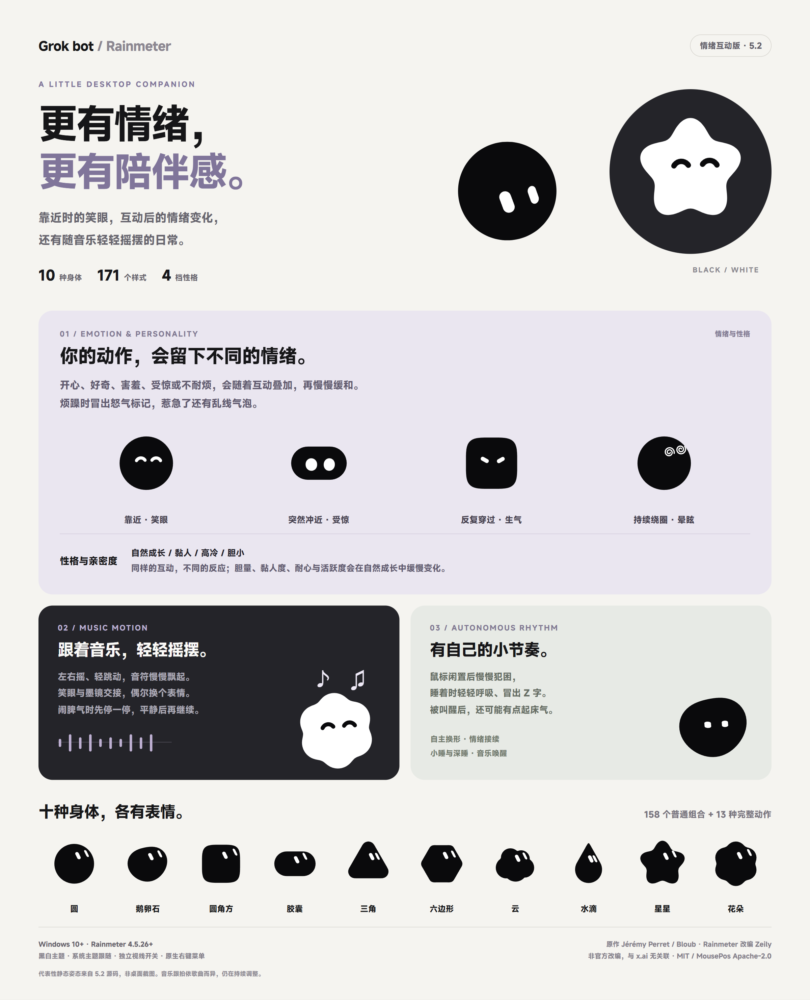

# Grok bot-Rainmeter

**English** | [简体中文](README.zh-CN.md)

A Rainmeter desktop companion with more emotion and a stronger sense of companionship. It responds through expressions and gaze, develops a personality through interaction and sways with music.

**5.0 · 171 styles · 10 bodies · Black and white themes**

## Features

- **Emotional interaction:** approaching gradually opens a smile; sudden approaches can startle it, repeated fast passes build impatience, and sustained circles or broad strokes can cause dizziness. Emotions accumulate and gradually settle.
- **Personality and affinity:** natural growth, clingy, aloof and timid modes give different responses to the same interaction. Natural growth slowly changes bravery, clinginess, patience and energy, while affinity builds over time.
- **Music motion:** side-to-side sway, gentle bounce and floating notes follow music from the default system output. Pointer interaction still gets a response while it dances.
- **Its own little rhythm:** occasional spontaneous smiles, boredom and brief naps add variety to its day. Shapes and emotions flow into one another; the skin window stays in place.
- **More shapes:** star and flower join the original bodies for 171 styles, with comfort ^^, spiral eyes, smooth morphing and black/white themes.

## Installation and upgrade

Requires Windows 10+ and Rainmeter 4.5.26.3894+.

Download **Zeily-bot_5.0.rmskin** from the [5.0 release](https://github.com/Zeilyintro/Grok-bot-Rainmeter/releases/tag/v5.0), double-click to install, then load `Bloub/Bloub.ini`. The installer includes Settings.inc and both MousePos architectures. Music uses Rainmeter's built-in AudioLevel; no additional music plugin is needed.

Before upgrading, back up `Bloub.ini` and `@Resources/Settings.inc`. Preserve your size, speed, switches and growth data after installation. Do not delete the installed skin first. Upgrading from 4.2 requires the complete installer, not a Lua-only replacement.

## Controls

- **Context menu:** system theme, white theme, mouse gaze, mouse interaction, music motion, interaction intensity, personality and growth/affinity reset. Menu labels are Chinese.
- **Theme:** disable system theme following before choosing a manual color.
- **Interaction:** gaze and pointer interaction have separate switches. Intensity offers auto, full and restrained modes. Left-click no longer changes styles.
- **Size and speed:** edit `Size` and `Speed` in `Bloub.ini`, then refresh. Preserve the INI's original UTF-16 encoding.

## Credits and licenses

Original: [Jérémy Perret / Bloub](https://github.com/jeremy-prt/bloub), [MIT](LICENSE). Rainmeter adaptation by Zeily. MousePos by [NSTechBytes](https://github.com/NSTechBytes/MousePos), with its [Apache-2.0](licenses/MousePos-Apache-2.0.txt) license retained.

This is an unofficial recreation of the x.ai bot's visual behavior with no affiliation to x.ai. The upstream license covers code, not the design it imitates.
