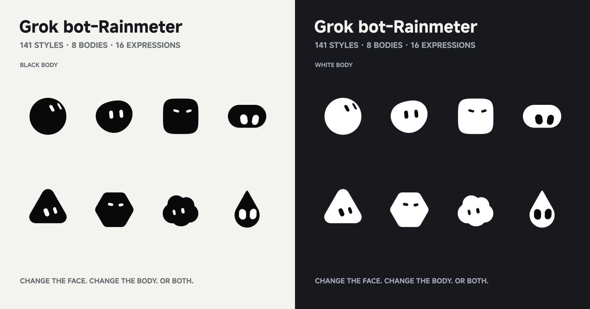

# Grok bot-Rainmeter

[English](README.md) | **简体中文**

更有情绪，也更有陪伴感。这个 Rainmeter 桌面 bot 会用眼神和表情回应你的靠近，在互动中慢慢形成性格，也会随着音乐摇摆。当前版本为 **5.0（171 样式）**，此前发布版为 4.2（141 样式）。


*介绍图从 v28 源码的姿态与轮廓数据静态绘制，不是桌面截图；展示代表性样式，并非全部 171 样式。可编辑页面见 [preview.html](docs/preview.html)。*

## 主要特点

- **情绪互动是这次的核心**：不再只是随机换表情。光标靠近会逐渐展开笑眼，突然冲近可能受惊，反复快速穿过会不耐烦、警惕甚至生气，持续绕圈或大幅来回会晕；多种情绪叠加后慢慢消退，用眼神和表情回应互动。
- **性格与亲密度**：自然成长、黏人、高冷、胆小四档；同样的互动会因性格而有不同反应。互动会缓慢影响胆量、黏人度、耐心和活跃度，成长与亲密度保存在 Settings.inc。
- **随音乐律动**：监听默认系统输出，跟踪节奏并预测拍点，左右摇摆、弱跳动和飘音符。跳舞时沿用自主停留与换形策略，屏蔽完整动作；鼠标互动和晕眩仍优先。个别歌曲仍可能受次节奏影响或跟拍不准。
- **更自然的自主节奏**：保留原有停留档位和变化权重，同时让情绪影响展示；没人互动时偶尔带着 ^^，长时间安静可能无聊、犯困和短盹。普通形态成型后至少 3 秒保护，动作结束回到当下情绪，减少接连抢换表情。窗口不会随互动移动。
- **171 样式与黑白主题**：原有 8 种身体增加星星、花朵，16 种基础表情和 13 种完整动作保留，去掉两个水滴组合；新增 ^^ 和蚊香眼覆盖。平滑换形、手动黑白主题和跟随系统沿用原版能力。

## 相比 GitHub 4.2

| 重点 | 4.2 发布版 | 当前 5.0 |
|---|---|---|
| 情绪与互动 | 随机样式、可选光标视线跟随 | 情绪叠加/衰减，靠近、穿过、绕圈等手势反应，^^ 与蚊香眼 |
| 性格与陪伴 | 没有性格成长系统 | 自然成长或三种固定性格，保存亲密度与成长 |
| 音乐律动 | 没有音频监听与律动 | 节奏跟踪、预测拍点、左右摇、弱跳动和飘音符 |
| 自主节奏 | 停留权重、避重、动作袋 | 保留原机制，增加展示保护、情绪回归、无聊/短盹及互动冲突处理 |
| 样式数量 | 8 身体、141 样式 | 10 身体、171 样式；基础表情与完整动作种类未增加 |
| 操作 | 左键换样式，3 个右键开关 | 取消左键切换，扩展为 8 项右键菜单 |

对照依据：[GitHub v4.2 README](https://github.com/Zeilyintro/Grok-bot-Rainmeter/blob/v4.2/README.zh-CN.md)、同标签的 INI/Lua 与本地 5.0 源码。介绍按情绪/性格、音乐、自主节奏、样式的顺序组织；黑白主题、平滑变形和鼠标视线跟随属于沿用能力。

## 安装与升级

需要 Windows 10+、Rainmeter 4.5.26.3894+。鼠标坐标使用 MousePos 插件，音乐使用 Rainmeter 内置 AudioLevel，无需额外音乐插件。

从 [5.0 发行页](https://github.com/Zeilyintro/Grok-bot-Rainmeter/releases/tag/v5.0) 下载 **Zeily-bot_5.0.rmskin**，双击安装，然后加载 `Bloub/Bloub.ini`。完整安装包包含 Settings.inc 和 32/64 位 MousePos 插件；不需要另外安装音乐插件。

升级前请备份已安装的 Bloub.ini 和 @Resources/Settings.inc。安装后保留自己的 Size、Speed、权重及主题/互动开关；希望保留性格成长和亲密度时，合并或恢复原 Settings.inc。不要先删除旧皮肤。

从 4.2 或早期测试版升级需更新完整 INI 与 Lua，不能只换 Lua。5.0 默认 Debug=0；需要调试时自行改为 1。手动安装插件只使用与你的 Rainmeter 位数相符的一份。

## 使用

右键菜单：跟随系统 / 白色主题 / 眼睛跟随鼠标 / 鼠标互动 / 随音乐律动 / 互动强度 / 性格 / 重置性格成长与亲密度。手动选色前先关闭系统主题跟随。

修改 Bloub.ini 的 Size、Speed 和停留/变化权重后刷新。INI 保持 UTF-16LE BOM，Lua 保持 ASCII。互动强度自动/完整/克制控制手势范围和门槛，不控制动画幅度或速度。音乐可选参数 MusicSway、MusicLead、MusicBounce 见 [详细说明](TEST-NOTES.zh-CN.md)。

## 当前状态与限制

5.0 基于最终 v28 源码发布。v13–v28 未运行离线模拟、Lua 加载/运行或桌面测试；文件和图片核对不代表原生运行通过。真实歌曲识别率、延迟、帧率、CPU 与配置写回尚未验证，音乐不能宣称已修复。自主选择受保护和情绪影响，不保证短时间看完全部样式。

源码、皮肤和安装包版本均为 5.0。包内 Settings.inc 提供初始配置；升级时需保留个人设置。

- [使用、升级与待观察说明](TEST-NOTES.zh-CN.md)
- [开发历史与旧验证](docs/DEVELOPMENT-HISTORY.zh-CN.md)

## 来源与许可

原作 [Jérémy Perret / Bloub](https://github.com/jeremy-prt/bloub)，[MIT](LICENSE)；Rainmeter 改编由 Zeily 整理。MousePos 来自 [NSTechBytes](https://github.com/NSTechBytes/MousePos)，保留 [Apache-2.0](licenses/MousePos-Apache-2.0.txt)。本项目是模仿 x.ai bot 视觉表现的非官方改编，与 x.ai 无关联；上游许可覆盖代码，不覆盖所模仿的设计。

<details>
<summary>4.2 发布版原说明（历史基线，含旧点击操作和安装方式）</summary>

以下内容保留原发布版说明，只适用于 4.2；不能据此为当前版本恢复左键切换或只替换 Lua 的首次升级流程。配图仍为该基线。

一个会变形、换表情的 Rainmeter 陪伴 bot，包含 **141 个样式**、平滑变形、黑白主题和可选鼠标视线跟随，也能单独换身体或表情。



*预览图由皮肤实际几何生成，并非桌面截图。*

## 安装

在[最新发行页](https://github.com/Zeilyintro/Grok-bot-Rainmeter/releases/tag/v4.2)下载 `Zeily-bot_4.0.rmskin`，双击安装，然后加载 `Bloub/Bloub.ini`。

已经安装？用 [Skins/Bloub](Skins/Bloub) 中的新版 `@Resources/Animation.lua` 替换原文件，再刷新即可保留自己的设置。

需要 Windows 10+、Rainmeter 4.5.26.3894+；安装包包含 32/64 位 MousePos 插件。

## 使用

- **左键**：切换下一个样式。
- **右键**：开关系统主题、白色主题、鼠标视线跟随。手动选色前先关闭系统主题跟随。
- **尺寸与速度**：修改 `Bloub.ini` 中的 `Size`、`Speed`，保存后刷新。中文 INI 保持 UTF-16 编码。

<details>
<summary>停留时间与变化偏好</summary>

在 `[Variables]` 中调整：

```ini
Size=130
Speed=1
ShortWeight=25
NormalWeight=45
LongWeight=30
ShortBurstGuard=1
ExpressionChangeWeight=40
BodyChangeWeight=35
BothChangeWeight=25
```

三项权重对应 **2–4 秒 / 8–15 秒 / 20–35 秒**，不必合计 100，0 禁用该档。`ShortBurstGuard=1` 减少连续短切换，0 关闭此限制。`Speed=1` 为原速，倍速不影响随机停留时长。

直立感叹号播完即切换；笔形态随机重放 2–4 次后切换，均不参与随机停留。

最后三项权重分别控制普通组合之间的**只换表情／只换身体／一起换**。0 禁用该类，三项全 0 恢复默认。近期样式避重，并避免连续三次同类型变化，因此实际比例会有变化。

141 个样式包括 **8 种身体 × 16 种表情**，以及 **13 个完整动画**。完整动画保留自己的眼睛动作和播放规则。

</details>

## 来源

原作：[Jérémy Perret / Bloub](https://github.com/jeremy-prt/bloub)，MIT 许可见 [LICENSE](LICENSE)。Rainmeter 改编由 Zeily 整理发布。

Bloub 重现了 x.ai bot 的视觉表现；本项目是非官方改编，与 x.ai 无关联。上游 MIT 许可覆盖代码，不覆盖其模仿的设计。

插件：[NSTechBytes / MousePos](https://github.com/NSTechBytes/MousePos)，原样附带，许可见 [Apache-2.0](licenses/MousePos-Apache-2.0.txt)。

皮肤版本为 4.2；用户制作的安装包保留 4.0 文件名及打包版本。验证采用离线模拟，实际帧率取决于桌面环境。

</details>
